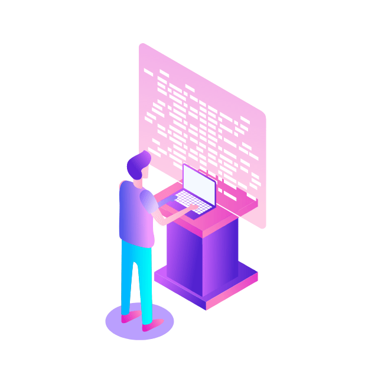
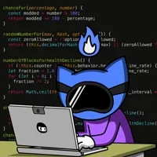

  I turn ideas into software that scales. With more than ten years of hands-on practice, I build modern web applications, design dependable backend services, and ship secure, fast systems to the cloud.

***

* 💼 **Role:** Senior Full-Stack Software Engineer
* 🎓 **Education:** Bachelor's degree in Computer Science
* 🛠️ **Go-to tools:** Node.js, ASP.NET Core, Django, Ruby on Rails, React, TypeScript, AWS, Azure
* 🏗️ **What I build:** microservices, real-time platforms, dashboards, and pixel-accurate interfaces
* 🎯 **Focus:** scalable, high-throughput system design
* 🚢 **Delivery:** guiding projects from the first idea through to production release
* 🤝 **Mentoring:** coaching junior developers and nurturing team collaboration
* ⚡ **Performance:** tuning speed and user experience
* 🔭 **Curiosity:** picking up new technologies as fast as the field changes

***

<b>🌐 Frontend</b>

  
  
  
  
  
  
  
  
  
  
  
  
  
  
  

<b>⚙️ Backend</b>

  
  
  
  
  
  
  
  
  
  
  
  
  

<b>🗄️ Data</b>

  
  
  
  
  

<b>☁️ Cloud & DevOps</b>

  
  
  
  
  
  
  
  
  
  

<b>🧪 Testing & Workflow</b>

  
  
  
  
  

***

  

  

  
  

  

***

Curious about my work or want to build something together? Take a look at my repositories and get in touch.

***

  

  Crafted with ❤️ by <a href="https://github.com/amazing-soft-dev">Amazing</a>

  
  
